

  

  
  <!-- Uncomment and fill these in:
  
  
  -->
  

  

## ⚡ Things I've built

  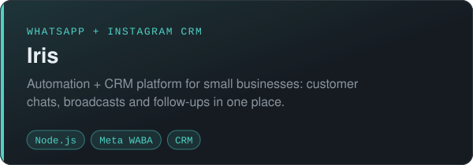
  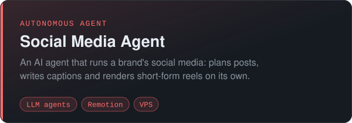
  <a href="https://github.com/KenAdams27/KOSH-Inventory-Dashboard">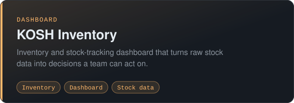</a>
  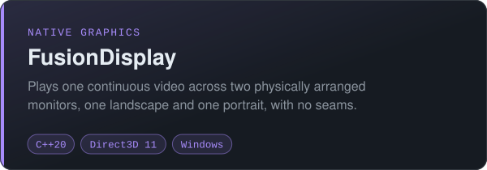
  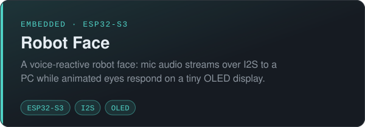
  <a href="https://github.com/KenAdams27/Bigram-LLM-Project">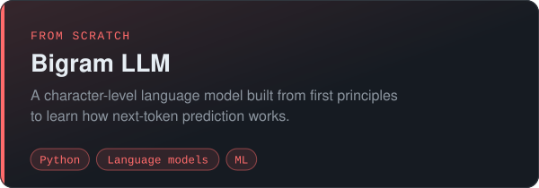</a>

## 🧰 Toolbox

  
  
  
  
  
  
  
   
  
  
  
  
  
   
  
  
  
  
  

## 📈 On GitHub

<!-- These images are generated by .github/workflows/profile-cards.yml into this repo -->

  <picture>
    <source media="(prefers-color-scheme: dark)" srcset="profile-summary-card-output/github_dark/0-profile-details.svg"/>
    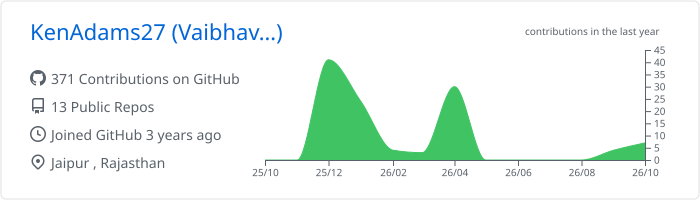
  </picture>

  <picture>
    <source media="(prefers-color-scheme: dark)" srcset="profile-summary-card-output/github_dark/3-stats.svg"/>
    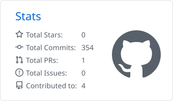
  </picture>
  <picture>
    <source media="(prefers-color-scheme: dark)" srcset="profile-summary-card-output/github_dark/1-repos-per-language.svg"/>
    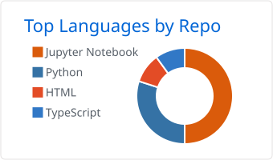
  </picture>

<!-- Generated by .github/workflows/snake.yml onto the `output` branch -->

  <picture>
    <source media="(prefers-color-scheme: dark)" srcset="https://raw.githubusercontent.com/KenAdams27/KenAdams27/output/github-snake-dark.svg"/>
    
  </picture>

  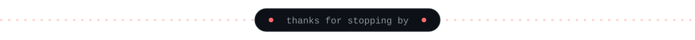

